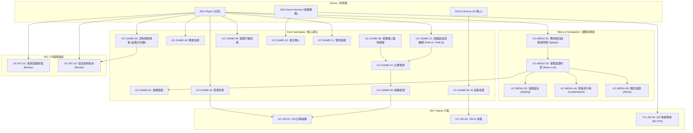
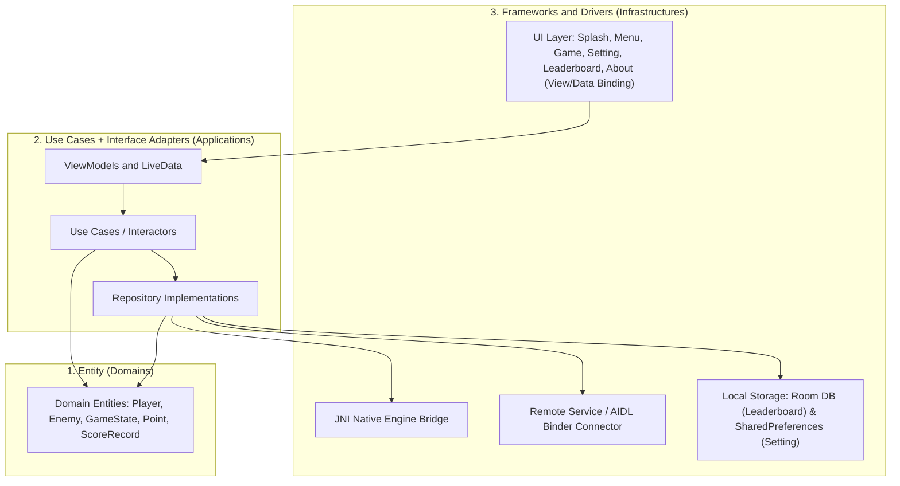
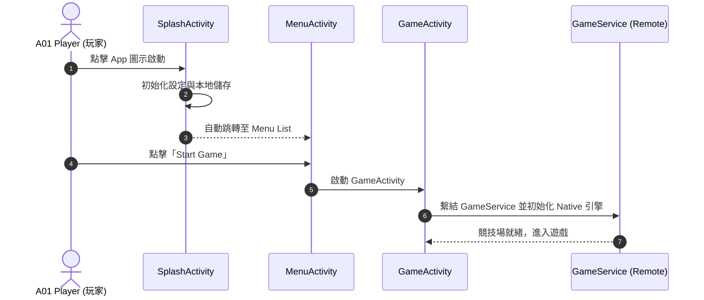
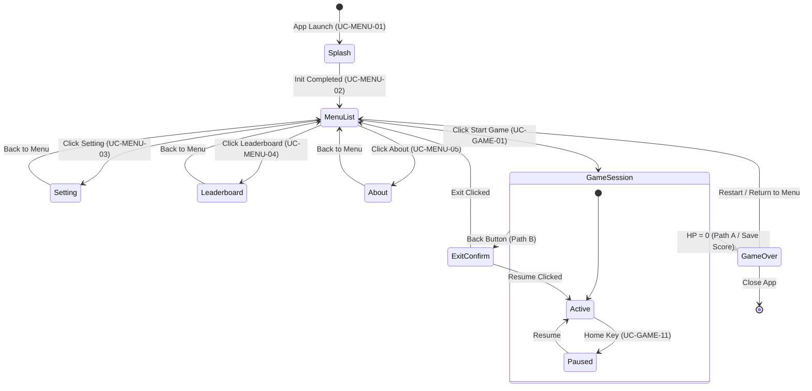
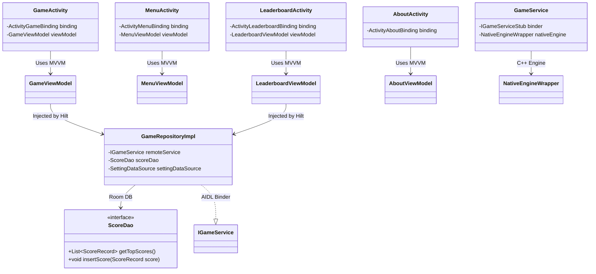
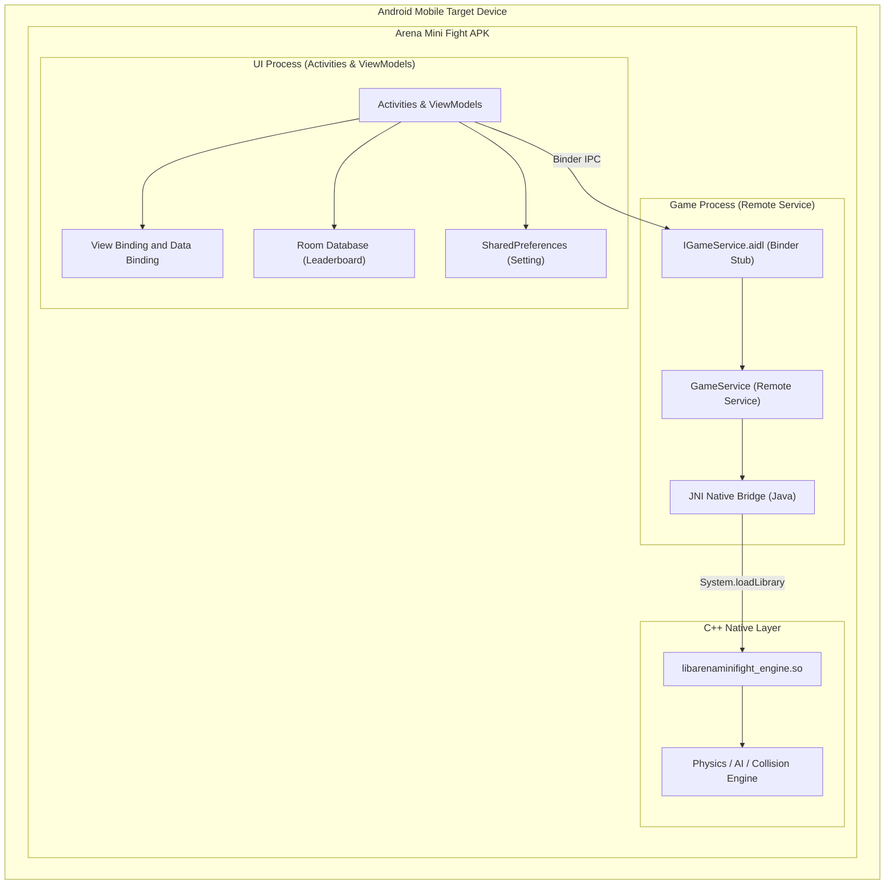

# Arena Mini Fight - Architecture Design Document (4+1 View Model + Modern Android Stack)

## Revision History / 版本歷史
| Date / 日期 | Version / 版本 | Description / 說明 | Author / 作者 |
| :--- | :--- | :--- | :--- |
| 2025-02-21 | 1.0.0 | Initial Architecture Design Document creation | Developer |
| 2025-02-21 | 2.0.0 | Updated Architecture Design with detailed Mermaid diagrams | Developer |
| 2025-02-21 | 3.0.0 | Added Menu navigation flow, Setting, and Leaderboard architecture components | Developer |
| 2025-02-21 | 3.1.0 | Added About screen navigation and UI component wiring in architecture views | Developer |

---

## 1. Introduction / 簡介
This document outlines the system architecture for **Arena Mini Fight**, adopting the **4+1 Architectural View Model** and modern Android architectural best practices (**MVVM**, **Clean Architecture**, **Hilt DI**, **View Binding**, and **Data Binding**). It traces directly to the System Requirements Specification (`system_requirement_spec.md`) and Use Case Specification (`use_case_spec.md`).

本文件概述 **Arena Mini Fight** 的系統架構，採用 **4+1 架構視圖模型** 與現代 Android 架構最佳實踐（**MVVM**、**Clean Architecture**、**Hilt DI**、**View Binding** 與 **Data Binding**）。本文件直接對應系統需求規格書與 Use Case 規格書。

---

## 2. 1. Use Case View / 使用案例視圖 (The "+1" View)
The Use Case View serves as the foundation, driving the architectural design by capturing the functional requirements and user interactions.

### 2.1 Use Case Diagram (Use Case 視圖方塊圖)

- **Traceability to SRS & Use Cases**:
  - **Menu Flow (`UC-MENU-01` ~ `UC-MENU-05`)**: Splash screen, Menu List routing, Setting persistence, Leaderboard Room DB querying, and About screen.
  - **Core Gameplay (`UC-GAME-01` ~ `UC-GAME-12`)**: Handled by UI, Domain Use Cases, Repositories, and Native C++ Engine.
  - **IPC Architecture (`UC-IPC-01` ~ `UC-IPC-02`)**: Handled across UI Process and Game Process via Android Binder (`IGameService.aidl`).
  - **JNI & Native Engine (`UC-JNI-01` ~ `UC-JNI-03`)**: Handled by Native Engine wrappers interfacing with C++ core for physics, collision, and pathfinding.

---

## 3. 2. Logical View / 邏輯視圖 (Clean Architecture + MVVM)
The Logical View describes the application's package structure, layers, and class-level responsibilities following **Clean Architecture** principles and **MVVM**.

### 3.1 Corrected Clean Architecture Layers (修正後的 Clean Architecture 分層)
According to the requested Clean Architecture hierarchy from **Inner to Outer**:

1. **Entity to Domains**: 
   - Core business models and domain entities (e.g., `Player`, `Enemy`, `GameState`, `Point`, `ScoreRecord`). This is the innermost core layer.
2. **Use Cases + Interface Adapters to Applications**: 
   - Interactors containing business rules, ViewModels, Presenters, and Repositories. This middle layer coordinates data flow and business logic between entities and frameworks.
3. **Frameworks & Drivers to Infrastructures**: 
   - UI layer (`SplashActivity`, `MenuActivity`, `GameActivity`, `SettingActivity`, `LeaderboardActivity`, `AboutActivity` with **View Binding** & **Data Binding**), local storage (Room DB & SharedPreferences), AIDL remote services (`IGameService.aidl`), and JNI native engine wrappers. This is the outermost layer.

---

## 4. 3. Process View / 行程與執行緒視圖 (Process View)
The Process View defines runtime processes, thread management, and IPC communication (`REQ-IPC-01` ~ `REQ-IPC-03`, `REQ-NFR-02`).

### 4.1 Multi-Process Architecture (Multi-Process Separation) / 多行程架構
To demonstrate advanced Android IPC and isolate game workload:
- **UI Process (`com.example.arenaminifight`)**:
  - Hosts `SplashActivity`, `MenuActivity`, `GameActivity`, `SettingActivity`, `LeaderboardActivity`, `AboutActivity`, ViewModels, View Binding, Data Binding, Room DB, and SharedPreferences.
- **Game Process (`com.example.arenaminifight:game`)**:
  - Hosts `GameService` (`Service` running in remote process), game loop ticks, C++ JNI Native Engine, physics simulation (`updateWorld`), and AI pathfinding.
- **IPC Communication**:
  - Connected via Android Binder IPC (`IGameService.aidl`).
  - `GameState getGameState();` (Polled / Observed by UI)
  - `movePlayer(float x, float y)` (Sent from UI to Game Service)

### 4.2 Sequence Diagram (序列方塊圖 - 應用程式啟動與選單流程)

### 4.3 State Diagram (狀態方塊圖 - App 導航與遊戲生命週期)

---

## 5. 4. Development view / 開發視圖 (Component & Dependency Injection with Hilt)
The Development View organizes the codebase into modular components and defines dependency injection wiring (`REQ-NFR-03`).

### 5.1 Class Diagram (類別方塊圖 - 架構關聯與 DI)

### 5.2 UI Binding Strategy / UI 綁定策略
- **View Binding**: Used across all layouts (`ActivitySplashBinding`, `ActivityMenuBinding`, `ActivityGameBinding`, `ActivitySettingBinding`, `ActivityLeaderboardBinding`, `ActivityAboutBinding`) to eliminate `findViewById` boilerplate and ensure null safety.
- **Data Binding**: Used in layout XML files for reactive variable binding (e.g., binding player HP, score, and leaderboard records directly to ViewModel observables).

---

## 6. 5. Physical View / 實體部署視圖 (Deployment View)
The Physical View describes how software artifacts are deployed onto target hardware and runtime environments.

### 6.1 Component Deployment Diagram (組件部署方塊圖)

### 6.2 Hardware & Runtime Target / 硬體與執行環境
- **Target Device**: Android Mobile Devices (Phones / Tablets running Android 8.0+ / API 26+).
- **Input Hardware**: Touchscreen virtual directional buttons and menu touch navigation (`UC-MENU-02`, `UC-GAME-02`).
- **Native Library Deployment**:
  - Compiled C++ shared libraries (`libarenaminifight_engine.so`) packaged inside the APK `.so` libraries directory, loaded via `System.loadLibrary("arenaminifight_engine")`.
- **Process Topology**:
  - Single APK containing dual-process declaration (`android:process=":game"` in `AndroidManifest.xml` for `GameService`).
