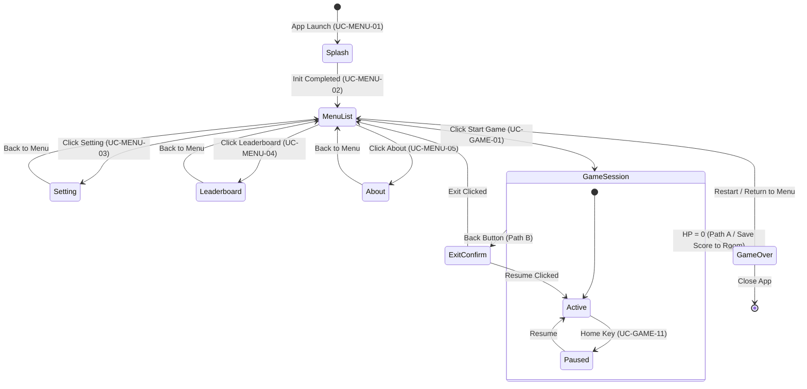
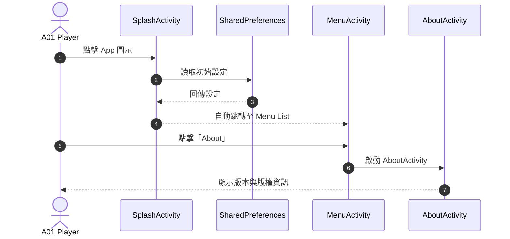
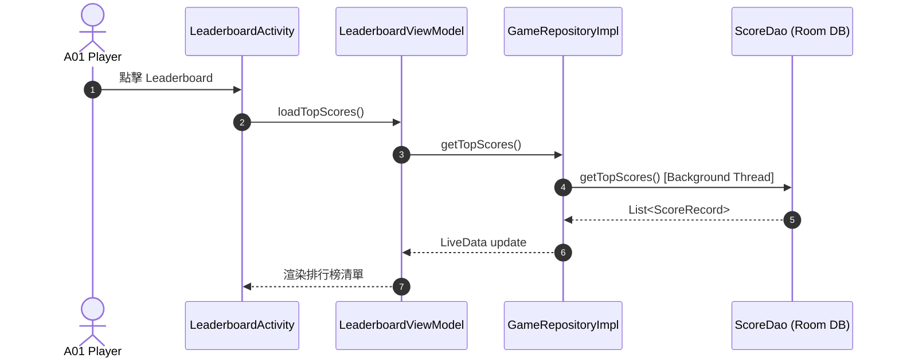

# Arena Mini Fight - Module Detail Design Specification

## Revision History / 版本歷史
| Date / 日期 | Version / 版本 | Description / 說明 | Author / 作者 |
| :--- | :--- | :--- | :--- |
| 2025-02-21 | 1.0.0 | Initial Module Detail Design Specification based on Logical View and Clean Architecture | Developer |
| 2025-02-21 | 1.1.0 | Updated Domain module language specification to Java | Developer |
| 2025-02-21 | 2.0.0 | Added Menu Flow, Setting, and Leaderboard detailed module designs | Developer |
| 2025-02-21 | 2.1.0 | Added About screen module specification, UI state, and traceability | Developer |

---

## 1. Introduction / 簡介
This document provides the comprehensive, detailed design specification for each architectural module in **Arena Mini Fight**, strictly following the **Logical View** and **Clean Architecture** layers (Primary implementation language: **Java**):
1. **Presentation Module (呈現層模組)** (`Frameworks & Drivers`)
2. **Domain Module (領域層模組 - Pure Java)** (`Entity` & `Use Cases`)
3. **Data Module (資料與基礎設施模組)** (`Interface Adapters` & `Frameworks & Drivers`)

本文件提供 **Arena Mini Fight** 三大架構模組的詳細設計規格，包含最新加入的 About 畫面模組設計。

---

## 2. References / 參考文件
- Use Case Specification: [`docs/use_case_spec.md`](file:///E:/AndroidStudioProjects/Game/ArenaMiniFight/docs/use_case_spec.md)
- System Requirement Specification: [`docs/system_requirement_spec.md`](file:///E:/AndroidStudioProjects/Game/ArenaMiniFight/docs/system_requirement_spec.md)
- Architecture Design Document: [`docs/architecture_design.md`](file:///E:/AndroidStudioProjects/Game/ArenaMiniFight/docs/architecture_design.md)
- UI/UX Design Specification: [`docs/ui_ux_design_spec.md`](file:///E:/AndroidStudioProjects/Game/ArenaMiniFight/docs/ui_ux_design_spec.md)

---

## 3. Module Scope / 模組範圍

### 3.1 Presentation Module (呈現層模組)
- **Scope**: `SplashActivity`, `MenuActivity`, `GameActivity`, `SettingActivity`, `LeaderboardActivity`, `AboutActivity`, ViewModels, View Binding, Data Binding, LiveData.
- **Traceability**: `UC-MENU-01` ~ `UC-MENU-05`, `UC-GAME-01` ~ `UC-GAME-04`, `UC-GAME-09`, `UC-GAME-11`, `UC-GAME-12`.

### 3.2 Domain Module (領域層模組 - Pure Java)
- **Scope**: Pure Java domain entities (`Player`, `Enemy`, `GameState`, `ScoreRecord`), use cases/interactors, repository interfaces.
- **Traceability**: Business logic for `UC-MENU-03`, `UC-MENU-04`, `UC-MENU-05`, `UC-GAME-05` ~ `UC-GAME-08`, `UC-GAME-10`.

### 3.3 Data Module (資料與基礎設施模組)
- **Scope**: Repository implementations, Room Database (`ScoreDao`, `AppDatabase`), SharedPreferences/DataStore for Settings, AIDL Binder IPC (`IGameService.aidl`), `GameService`, and JNI native wrappers (`NativeEngineWrapper.java`).
- **Traceability**: `UC-MENU-03`, `UC-MENU-04`, `UC-IPC-01`, `UC-IPC-02`, `UC-JNI-01` ~ `UC-JNI-03`.

---

## 4. Module Architecture / 模組架構
```
[Presentation Module] (Activities, ViewModels, View/Data Binding in Java)
          ↓ (Depends on)
[Domain Module] (Pure Java Use Cases, Entities, Interfaces)
          ↑ (Implemented by)
[Data Module] (Repository Impl, Room DB, SharedPreferences, AIDL Binder, JNI Bridge in Java)
```

---

## 5. Interface Design / 介面設計

### 5.1 Presentation Interface (ViewModel to UI in Java)
```java
public interface MenuUiState {
    LiveData<Boolean> getIsLoading();
}

public interface SettingUiState {
    LiveData<Float> getSoundVolume();
    LiveData<Integer> getGraphicsQuality();
}

public interface LeaderboardUiState {
    LiveData<List<ScoreRecord>> getTopScores();
}

public interface AboutUiState {
    LiveData<String> getAppVersion();
    LiveData<String> getCopyrightInfo();
}
```

### 5.2 Domain Interface (Repository Contract in Java)
```java
public interface GameRepository {
    LiveData<GameState> getGameState();
    void movePlayer(float x, float y);
    void attack();
    void castSkill(int skillId);
    
    // Setting & Leaderboard
    float getSoundVolume();
    void saveSoundVolume(float volume);
    List<ScoreRecord> getTopScores();
    void saveScore(ScoreRecord score);
}
```

### 5.3 Data Interfaces (Room DAO, AIDL & JNI)
- **Room DAO (`ScoreDao.java`)**:
  ```java
  @Dao
  public interface ScoreDao {
      @Query("SELECT * FROM scores ORDER BY survivalTime DESC LIMIT 10")
      List<ScoreRecord> getTopScores();

      @Insert
      void insertScore(ScoreRecord score);
  }
  ```
- **AIDL IPC Interface (`IGameService.aidl`)**:
  ```java
  package com.example.arenaminifight;
  import com.example.arenaminifight.GameState;
  interface IGameService {
      GameState getGameState();
      void movePlayer(float x, float y);
      void attack();
      void castSkill(int skillId);
  }
  ```
- **JNI Native Interface (`NativeEngineWrapper.java`)**:
  ```java
  public class NativeEngineWrapper {
      public native boolean checkCollision(long id1, long id2);
      public native float[] pathFind(float startX, float startY, float endX, float endY);
      public native void updateWorld(float deltaTime);
      public native void spawnEnemy();
  }
  ```

---

## 6. Data Design / 資料設計

### 6.1 Domain Entities (`Domain Module` - Pure Java)
- **Player**: `id`, `x`, `y`, `hp`, `maxHp`, `attack`, `defense`, `exp`, `level`, `killCount`
- **Enemy**: `id`, `type`, `x`, `y`, `hp`, `attack`
- **GameState**: `player`: Player, `enemies`: List<Enemy>, `isGameOver`: boolean, `survivalTime`: long
- **ScoreRecord**: `id`, `playerName`, `survivalTime`, `killCount`, `level`, `timestamp`

### 6.2 Data Transfer Objects & Storage Entities (`Data Module`)
- **ScoreEntity (@Entity)**: Room Database table entity for leaderboard persistence (`UC-MENU-04`).
- **GameState.aidl**: Implements `Parcelable` in Java for cross-process IPC transmission via Binder (`UC-IPC-01`).

---

## 7. State Machine Design / 狀態機設計


---

## 8. Sequence Design / 序列設計

### 8.1 App Launch & Menu Navigation (`UC-MENU-01` ~ `UC-MENU-05`)


### 8.2 Leaderboard Query (`UC-MENU-04`)


---

## 9. Error Handling / 錯誤處理
- **Presentation Module**: Catches UI input anomalies and displays graceful dialogs or toasts using View Binding references.
- **Domain Module**: Validates business rules in Java interactors (e.g., checks score validity before saving).
- **Data Module**:
  - **IPC Disconnection (`DeadObjectException`)**: Caught in `GameRepositoryImpl` (Java), triggering automatic re-binding to `GameService` (`REQ-NFR-02`).
  - **Room DB Query Failures**: Handled with try-catch blocks and fallback empty lists to prevent crashes on the UI thread (`REQ-NFR-04`).
  - **JNI Null / Invalid Pointers**: Checked at JNI boundary in C++/Java; returns safe fallback values (`false` or empty arrays) and logs native errors (`UC-JNI-01`).

---

## 10. Concurrency Design / 併發模型設計
- **Presentation Module**: Android Main (UI) Thread handles View rendering, touch event capture, and View/Data Binding updates.
- **Data Module (Storage & Room)**: Background Executor / Coroutines Dispatchers.IO for asynchronous Room DB queries and SharedPreferences writes (`REQ-NFR-04`).
- **Data Module (IPC)**: Android-managed Binder Thread Pool processes incoming remote IPC calls (`IGameService`).
- **Data Module (Game Engine)**: Dedicated background Java worker thread inside `GameService` driving the 60 FPS physics loop (`updateWorld`) and C++ engine execution (`REQ-NFR-01`).

---

## 11. Storage Design / 儲存設計
- **SharedPreferences / DataStore**: Used in Data Module for storing lightweight app settings (audio volume, graphics quality).
- **Room Database**: SQLite-based local storage (`AppDatabase`, `scores` table) for persisting player survival scores and kill counts (`UC-MENU-04`, `REQ-NFR-04`).

---

## 12. Configuration Design / 配置設計
- **Build Variants**: `debug` (logging enabled, assertions active) and `release` (ProGuard / R8 optimization enabled, native symbols stripped).
- **Process Declaration**: `AndroidManifest.xml` sets `android:process=":game"` for `GameService`.

---

## 13. Logging Design / 日誌設計
- **Presentation & Domain**: Tagged Java logging (`Log.d("ArenaMiniFightTag", ...)`) in Activities, ViewModels, and Use Cases.
- **Data & Native**: Android NDK `__android_log_print` used in C++ engine and JNI bridge for high-performance physics and IPC debugging.

---

## 14. Unit Test Design / 單元測試設計
- **Presentation Tests**: JUnit 4 + Mockito to test Java ViewModel LiveData emissions.
- **Domain Tests**: Pure Java unit tests validating business rules (e.g., `CalculateDamageUseCase` formula, score sorting logic).
- **Data Tests**: Room in-memory database testing for `ScoreDao`, and AIDL Binder connection verification.

---

## 15. Traceability Matrix / 需求追溯矩陣
| Module | Component / Class | Traced SRS / Use Case |
| :--- | :--- | :--- |
| **Presentation Module** | `SplashActivity`, `MenuActivity`, `SettingActivity`, `LeaderboardActivity`, `AboutActivity`, ViewModels | `UC-MENU-01` ~ `UC-MENU-05`, `REQ-MENU-01` ~ `REQ-MENU-05` |
| **Presentation Module** | `MainActivity` (`GameActivity`), `GameViewModel`, View/Data Binding | `UC-GAME-01` ~ `UC-GAME-04`, `UC-GAME-09`, `UC-GAME-11`, `UC-GAME-12`, `REQ-GAME-01` ~ `REQ-GAME-04` |
| **Domain Module** | `UseCases`, `Entities` (`ScoreRecord`, `Player`, `GameState`), `GameRepository` (Interface) | `UC-MENU-03` ~ `UC-MENU-05`, `UC-GAME-05` ~ `UC-GAME-08`, `UC-GAME-10`, `REQ-GAME-05` ~ `REQ-GAME-10` |
| **Data Module** | `GameRepositoryImpl`, `ScoreDao` (Room DB), `SharedPreferences` (Setting), `GameService`, `IGameService.aidl`, `NativeEngineWrapper` | `UC-MENU-03`, `UC-MENU-04`, `UC-IPC-01`, `UC-IPC-02`, `UC-JNI-01` ~ `UC-JNI-03`, `REQ-IPC-01` ~ `REQ-IPC-03`, `REQ-JNI-01` ~ `REQ-JNI-03`, `REQ-NFR-01`, `REQ-NFR-02`, `REQ-NFR-04` |
