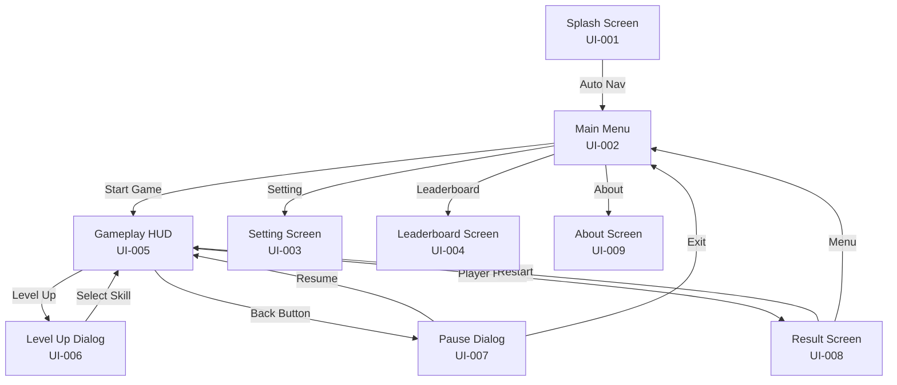

# Arena Mini Fight - UI/UX Design Specification

## Revision History / 版本歷史
| Date / 日期 | Version / 版本 | Description / 說明 | Author / 作者 |
| :--- | :--- | :--- | :--- |
| 2025-02-21 | 1.0.0 | Initial UI/UX Design Specification creation | Developer |
| 2025-02-21 | 1.1.0 | Added About Screen specification and updated navigation flow and Mermaid diagrams | Developer |

---

## 1. UI Design Philosophy / UI 設計理念
Arena Mini Fight adopts a **Neon Sci-Fi Arena** style.
Arena Mini Fight 採用 **Neon Sci-Fi Arena** 風格。

### Design Goals / 設計目標：
- **Clean / 簡潔**: Minimalist HUD overlay to prevent visual clutter during intense combat.
- **High Readability / 高可讀性**: High contrast glowing neon elements against dark sci-fi backgrounds.
- **One-handed Operation / 單手操作**: Optimized touch targets and virtual D-pad placement for mobile ergonomics.
- **Combat Info Priority / 戰鬥資訊優先**: HP, EXP, Kill Count, and Timer are prominently pinned to the top/corners.
- **Fast Response / 快速反應**: Immediate visual and haptic feedback on button presses and touches.

### References / 參考遊戲：
- Survivor.io
- Brotato
- Soul Knight

---

## 2. Color Palette / 色彩配置
| Name / 名稱 | Hex Code / 色碼 | Description / 用途說明 |
| :--- | :--- | :--- |
| **Background** | `#10141D` | Deep space dark background for arena and menus |
| **Primary** | `#00E5FF` | Cyan neon glow for main buttons, highlights, and player elements |
| **Secondary** | `#8C52FF` | Purple neon glow for special skills, magic effects, and borders |
| **Danger** | `#FF3B5C` | Neon red for enemies, damage numbers, and HP bars |
| **Warning** | `#FFB800` | Amber gold for timers, warnings, and level-up items |
| **Success** | `#29CC6A` | Neon green for EXP gain, healing, and success states |

---

## 3. Typography / 字型與排版
- **Title (標題)**: 28sp (Bold)
- **Subtitle (副標題)**: 20sp (Medium)
- **Body (內文)**: 16sp (Regular)
- **Button (按鈕文字)**: 18sp (Medium)

### Android Fonts / Android 字型：
- **Primary Font**: Roboto
- **Styling Font**: Montserrat

---

## 4. Navigation Flow / 導航流程


---

## 5. Screen Specification / 畫面規格

### UI-001 Splash Screen
- **Function / 功能**: Display game logo, initialize resources (`UC-MENU-01`).
- **Layout Wireframe / 畫面佈局**:
  ```text
  +--------------------------------+
  |                                |
  |         [ Arena Fight ]        |
  |         Neon Sci-Fi Logo       |
  |                                |
  |          Loading...            |
  |          [==========]          |
  |                                |
  +--------------------------------+
  ```

### UI-002 Main Menu
- **Function / 功能**: Navigation hub with buttons for Start Game, Setting, Leaderboard, and About (`UC-MENU-02`).
- **Layout Wireframe / 畫面佈局**:
  ```text
  +--------------------------------+
  |         ARENA MINI FIGHT       |
  |                                |
  |       [   START GAME   ]       |
  |       [    SETTING     ]       |
  |       [  LEADERBOARD   ]       |
  |       [     ABOUT      ]       |
  |                                |
  +--------------------------------+
  ```

### UI-003 Setting
- **Function / 功能**: Adjust audio volume, graphics quality, and control sensitivity (`UC-MENU-03`).
- **Layout Wireframe / 畫面佈局**:
  ```text
  +--------------------------------+
  |            SETTING             |
  |                                |
  |  Sound Volume   [----o-----]   |
  |  Graphics       [ Low / Hi ]   |
  |  Sensitivity    [--o-------]   |
  |                                |
  |          [ BACK TO MENU ]      |
  +--------------------------------+
  ```

### UI-004 Leaderboard
- **Function / 功能**: Display Top 10 scores, survival time, and kill counts (`UC-MENU-04`).
- **Layout Wireframe / 畫面佈局**:
  ```text
  +--------------------------------+
  |          LEADERBOARD           |
  |                                |
  |  1. PlayerA   - 05:20 - Kills:45 |
  |  2. PlayerB   - 04:10 - Kills:30 |
  |  3. PlayerC   - 03:50 - Kills:25 |
  |                                |
  |          [ BACK TO MENU ]      |
  +--------------------------------+
  ```

### UI-009 About Screen
- **Function / 功能**: Display application version, copyright info, and brief game instructions (`UC-MENU-05`).
- **Layout Wireframe / 畫面佈局**:
  ```text
  +--------------------------------+
  |           ABOUT GAME           |
  |                                |
  |       Arena Mini Fight         |
  |          Version 1.0.0         |
  |                                |
  |   Top-down arena survival game |
  |   powered by C++ Native Engine |
  |   and Android IPC / Binder.    |
  |                                |
  |          [ BACK TO MENU ]      |
  +--------------------------------+
  ```

### UI-005 Gameplay HUD
- **Function / 功能**: Virtual directional buttons, skill buttons, HP bar, EXP bar, Level, Kill Count, and Timer (`UC-GAME-02` ~ `UC-GAME-09`).
- **Layout Wireframe / 畫面佈局**:
  ```text
  +--------------------------------+
  | HP: [=======    ]  Level: 3    |
  | EXP:[=====      ]  Kills: 12   |
  | Timer: 02:15                   |
  |                                |
  | (D-Pad)                  [SKILL]
  |  [Up]                    [ATK] |
  |[L] [R]                         |
  | [Down]                         |
  +--------------------------------+
  ```

### UI-006 Level Up Dialog
- **Function / 功能**: Pause game and display skill upgrade cards (`UC-GAME-09`).
- **Layout Wireframe / 畫面佈局**:
  ```text
  +--------------------------------+
  |          LEVEL UP!             |
  |     Choose Your Upgrade        |
  |                                |
  |  +--------------------------+  |
  |  | [Icon] FireBall          |  |
  |  +--------------------------+  |
  |  +--------------------------+  |
  |  | [Icon] Shield            |  |
  |  +--------------------------+  |
  +--------------------------------+
  ```

### UI-007 Pause Dialog
- **Function / 功能**: Pause game execution when Back button is pressed (`UC-GAME-11`, `UC-GAME-12` Path B).
- **Layout Wireframe / 畫面佈局**:
  ```text
  +--------------------------------+
  |            PAUSED              |
  |                                |
  |      [ RESUME ]   [ EXIT ]     |
  +--------------------------------+
  ```

### UI-008 Result Screen
- **Function / 功能**: Game Over summary displaying score, kills, survival time (`UC-GAME-12` Path A).
- **Layout Wireframe / 畫面佈局**:
  ```text
  +--------------------------------+
  |           GAME OVER            |
  |                                |
  |    Survival Time : 04:32       |
  |    Total Kills   : 38          |
  |                                |
  |      [ RESTART ]   [ MENU ]    |
  +--------------------------------+
  ```

---

## 6. UI Component Library / UI 共用元件庫
- **PrimaryButton**: Cyan glowing button (`#00E5FF`) for primary actions.
- **SecondaryButton**: Purple glowing button (`#8C52FF`) for secondary actions.
- **SkillCard**: Glassmorphic card container with neon borders.
- **Dialog**: Dark sci-fi modal container with glowing neon borders.
- **LeaderboardItem**: Row layout displaying rank, player name, survival time, and kills.
- **VirtualJoystick / Virtual D-pad**: Touch-responsive directional buttons (`UC-GAME-02`).
- **SkillButton**: Circular glowing action buttons (`UC-GAME-03`, `UC-GAME-04`).

---

## 7. Animation Specification / 動畫規格
- **Splash FadeIn**: 2000ms ease-in-out transition.
- **Button Click**: 100ms scale down (95%) and color flash.
- **Level Up Popup**: 300ms spring-physics popup scaling.
- **Game Over Popup**: 500ms slide-in from top.

---

## 8. Art Asset Specification / 美術與資產規格
- **Character Size**: 64x64 px
- **Enemy Size**: 48x48 px
- **Skill Icon**: 128x128 px
- **Portrait / Splash Art**: 512x512 px / 1920x1080 px
- **Background**: 1920x1080 px seamless dark sci-fi grid texture.
